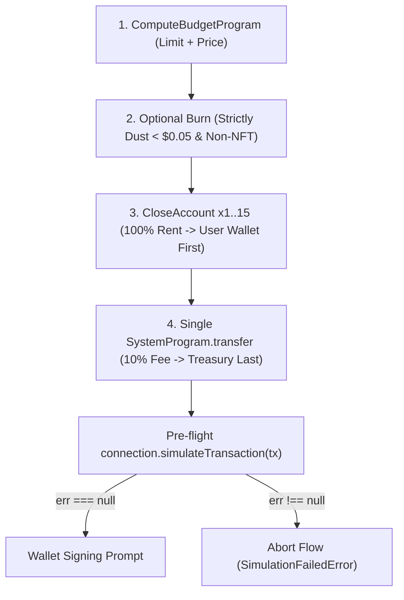

# DegenSuite Security Architecture Specification

> **Official Security & Domain Verification Reference**
> - **Production Domain:** `https://degensuite.xyz`
> - **Official X (Twitter):** `https://x.com/degensuite_xyz` (`@degensuite_xyz`)
> - **Official Telegram Alerts:** `https://t.me/degensuitealert` (`@degensuitealert`)
> - **Verification Repository:** `https://github.com/anggasetiawanw/degensuite-xyz`
> - **Security Contact:** `security@degensuite.xyz`

This document provides a technical specification of all client-signed Solana transactions built by **DegenSuite** for wallet security reviewers (**Blowfish**, **Phantom**, **Solflare**, **Backpack**).

---

## 1. Threat Model & Custody Guarantees

- **100% Non-Custodial:** DegenSuite never requests, generates, stores, or transmits private keys or seed phrases.
- **No Custom On-Chain Programs:** DegenSuite deploys **no custom Solana smart contracts**. All transactions use standard, immutable Solana native and SPL Token instructions.
- **No Blind Signing or Arbitrary Authority Delegation:** DegenSuite never adds `SetAuthority` or `Approve` instructions. `WalletGuard` exclusively **revokes** existing token delegates (`createRevokeInstruction`), and `VaultSweep` exclusively **closes** user-owned token accounts (`createCloseAccountInstruction`) after verifying balances and safety invariants.
- **Read-Only Analytics Isolation:** `RugShield`, `ClusterGraph`, `KOLWatch`, and `DegenLedger` operate solely on public Base58 addresses (`mint` or `wallet`) without requiring a connected wallet.
- **Server-Side RPC Key Isolation:** All private RPC credentials (`HELIUS_API_KEY`, `DATABASE_URL`, `REDIS_URL`, `TELEGRAM_BOT_TOKEN`) are strictly server-side (`NEXT_PUBLIC_` is never used).

---

## 2. Transaction Instruction Layouts

### 2.1 `VaultSweep` (`src/lib/solana/tx-builder/vault-sweep.ts`)

`VaultSweep` closes up to **15** eligible Associated Token Accounts per transaction (`MAX_ACCOUNTS_PER_TX = 15`), reclaiming ~`0.00203928 SOL` (`2,039,280` lamports) of rent per 165-byte SPL Token Account directly to the user's wallet.

#### Instruction Order (Strict Invariant)

```text
+-------------------------------------------------------------------------+
| 1. ComputeBudgetProgram.setComputeUnitLimit                             |
| 2. ComputeBudgetProgram.setComputeUnitPrice                             |
+-------------------------------------------------------------------------+
| 3. [OPTIONAL] splToken.createBurnInstruction (x0..N)                    |
|    - Strictly skipped in default zero-balance mode                      |
|    - Only permitted when ALL guards pass:                               |
|        userConfirmedDustBurn === true                                   |
|        decimals !== 0 (NFT protection)                                  |
|        verifiedUsdValue !== null && verifiedUsdValue < 0.05             |
+-------------------------------------------------------------------------+
| 4. splToken.createCloseAccountInstruction (x1..15)                      |
|    - destination: 100% -> userPublicKey (User receives full rent FIRST) |
|    - authority: userPublicKey                                           |
+-------------------------------------------------------------------------+
| 5. SystemProgram.transfer (placed STRICTLY LAST)                        |
|    - fromPubkey: userPublicKey                                          |
|    - toPubkey: TREASURY_WALLET_PUBKEY                                   |
|    - lamports: (batchReclaimedLamports * 1000n) / 10000n (exact 10%)    |
|    - Net user SOL delta remains ~+90% of reclaimed rent                 |
+-------------------------------------------------------------------------+
```



#### Enforced Safety Guards (`VaultSweep`)
| Guard | Condition | Behavior |
| :--- | :--- | :--- |
| **Frozen Account Filter** | `account.state === "frozen"` | Automatically excluded into `skippedFrozenAccounts` without failing valid batches |
| **Zero-Balance Enforcement** | `rawAmount > 0n` when `!userConfirmedDustBurn` | Throws `NonZeroBalanceError` immediately |
| **NFT / Collectible Guard** | `decimals === 0` during dust burn | Throws `UnsafeBurnError` immediately |
| **Valuable Token Guard** | `verifiedUsdValue >= 0.05` | Throws `UnsafeBurnError` immediately |
| **Unpriced Asset Guard** | `verifiedUsdValue === null \| undefined \| NaN \| < 0` | Throws `UnsafeBurnError` immediately |
| **BigInt Precision** | `calculateFeeSplit(lamports)` | Uses `BigInt` (`1000n / 10000n`), zero floating-point math |
| **Packet Size Bound** | `MAX_ACCOUNTS_PER_TX = 15` | Chunks batches (`35 -> 15 + 15 + 5`) safely under 1232-byte MTU |

---

### 2.2 `WalletGuard` (`src/lib/solana/tx-builder/wallet-guard.ts`)

`WalletGuard` revokes active SPL token delegates so third-party programs or hot wallets can no longer transfer tokens on the user's behalf. **Platform fee is 0%.**

```text
+-------------------------------------------------------------------------+
| 1. ComputeBudgetProgram.setComputeUnitLimit                             |
| 2. ComputeBudgetProgram.setComputeUnitPrice                             |
+-------------------------------------------------------------------------+
| 3. splToken.createRevokeInstruction (x1..15)                            |
|    - account: delegated token account                                   |
|    - owner: userPublicKey                                               |
|    - Automatically skips accounts with delegate === null or frozen      |
+-------------------------------------------------------------------------+
```

---

### 2.3 `ProPassPayment` (`src/lib/solana/tx-builder/pass-payment.ts`)

`buildProPassPaymentTransaction` constructs an explicit, fixed-amount Solana Pay checkout transfer (`PRO_PASS_PRICE_LAMPORTS = 200_000_000n` = `0.20 SOL`) with a non-signer, non-writable reference key attached so the backend can confirm payment finality via `getSignaturesForAddress`.

```text
+-------------------------------------------------------------------------+
| 1. ComputeBudgetProgram.setComputeUnitLimit (25,000 CU)                 |
| 2. ComputeBudgetProgram.setComputeUnitPrice                             |
+-------------------------------------------------------------------------+
| 3. SystemProgram.transfer                                               |
|    - fromPubkey: payerPublicKey                                         |
|    - toPubkey: TREASURY_WALLET_PUBKEY (self-transfer blocked)           |
|    - lamports: 200,000,000n (BigInt)                                    |
|    - keys: appends non-signer, read-only Solana Pay referencePublicKey  |
+-------------------------------------------------------------------------+
```

---

## 3. Mandatory Pre-Flight Simulation & Unsigned `signAndSendTransaction`

Before any wallet extension (`Phantom`, `Solflare`, etc.) is asked to approve a transaction:
1. Client executes `await connection.simulateTransaction(tx)` via [`simulateVaultSweepTransactions`](src/lib/solana/tx-builder/vault-sweep.ts) or [`simulateWalletGuardTransactions`](src/lib/solana/tx-builder/wallet-guard.ts).
2. If `simulation.value.err !== null`, execution aborts immediately and surfaces a structured error (`failedBatchIndex`, `error`, `logs`) without prompting the wallet.
3. Passing transactions are submitted via [`signAndSendUnsignedTransaction`](src/lib/solana/tx-builder/vault-sweep.ts), which resets `tx.signatures = []` and routes the unsigned `Transaction` through `signAndSendTransaction` (`window.phantom.solana.signAndSendTransaction` or Wallet Standard `solana:signAndSendTransaction` via `sendTransaction`). Because each batch caps at `MAX_ACCOUNTS_PER_TX = 15` (`<= LIGHTHOUSE_MAX_SAFE_TX_BYTES = 1050` bytes), Phantom / Blowfish Lighthouse guard instructions fit cleanly inside the 1232-byte Solana packet limit.

---

## 4. Automated Test Verification

All safety invariants above are covered by automated Vitest assertions in [`src/__tests__/vault-sweep.test.ts`](src/__tests__/vault-sweep.test.ts):

1. **Batching Test:** 35 empty accounts produce exactly 3 transactions (`15 + 15 + 5`).
2. **Fee Math Test:** 10 accounts (`20,392,800` lamports) produce an exact `2,039,280` lamport treasury transfer and `18,353,520` net lamports for the user.
3. **Asset Safety Guard Test:** Non-zero accounts in zero-balance sweep throw `NonZeroBalanceError`.
4. **Frozen Account Guard Test:** Frozen accounts are skipped cleanly into `skippedFrozenAccounts`.
5. **Instruction Ordering Test:** Every transaction orders `ComputeBudget` → `Burn` (if verified dust) → `CloseAccount` (`destination === userPublicKey`) → `SystemProgram.transfer` (last).
6. **NFT & Valuable Asset Protection Test:** `decimals === 0`, `verifiedUsdValue >= 0.05`, and `verifiedUsdValue === null` throw `UnsafeBurnError`.
7. **Pre-Flight Simulation Guard Test:** Non-null simulation errors abort immediately.
8. **WalletGuard Revoke Builder Test:** Batches up to 15 accounts and skips frozen or non-delegated accounts.
9. **Lighthouse Guard Headroom & Unsigned `signAndSendTransaction` Test:** Verifies a full 15-account batch serializes `<= 1050` bytes (`LIGHTHOUSE_MAX_SAFE_TX_BYTES`) and `signAndSendUnsignedTransaction` clears signature slots before calling `signAndSendTransaction`.

---

## 5. Security Contact & Disclosure

- **Security Email:** `security@degensuite.xyz`
- **Production App:** `https://degensuite.xyz`
- **Official X:** `https://x.com/degensuite_xyz`

If you represent a wallet security provider (Blowfish, Phantom, Solflare, Blockaid) and require DNS TXT verification or additional transaction trace evidence, please contact `security@degensuite.xyz` or refer to [`docs/WALLET_ALLOWLIST_GUIDE.md`](docs/WALLET_ALLOWLIST_GUIDE.md).
